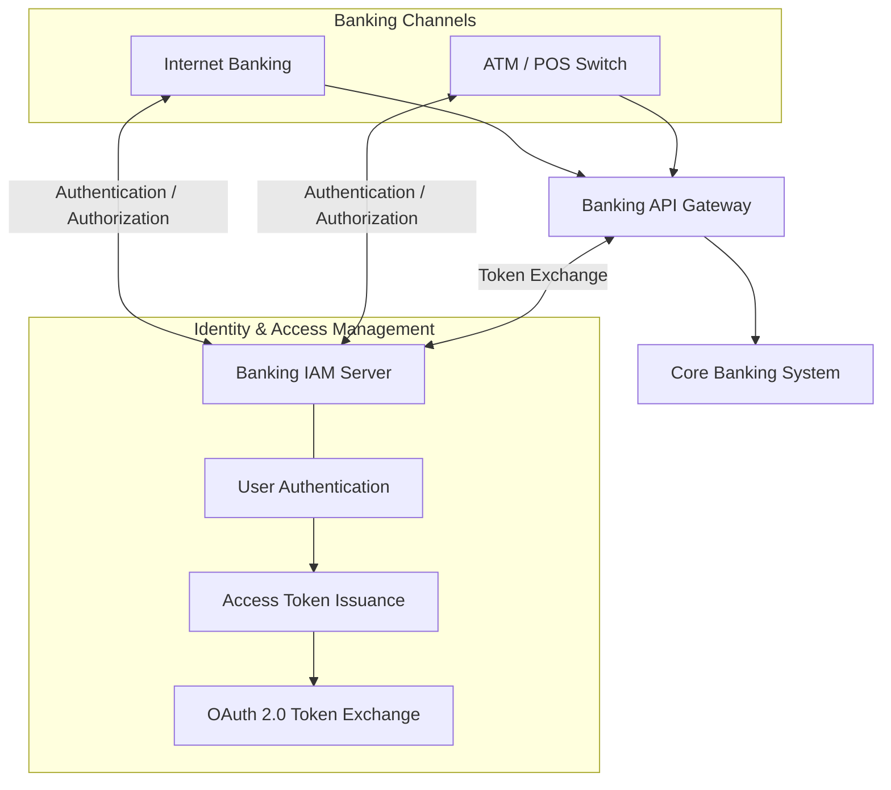

# Banking IAM Server

<p align="center">
  
  
  
  
  
  
  
</p>

A centralized Identity and Access Management (IAM) service for a modular banking ecosystem, built with Spring Authorization Server and Spring Security. It provides authentication, OAuth 2.0 authorization, JWT-based access tokens, and secure token exchange for banking applications and services.

## Overview

**Banking IAM Server** serves as the centralized identity and authorization infrastructure for the banking platform.

It manages application clients, user authentication, access-token issuance, and authorization policies across multiple banking channels and backend services.

Rather than implementing authentication independently in every application, banking channels delegate identity verification and authorization to the IAM Server.

The service also supports OAuth 2.0 Token Exchange, allowing trusted applications and infrastructure components to obtain appropriately scoped and audience-restricted tokens when communicating with downstream banking services.

## Architecture



## Core Responsibilities

- **Centralized Authentication:** Provides a unified authentication service for banking applications.
- **OAuth 2.0 Authorization Server:** Manages OAuth 2.0 clients, authorization grants, and token issuance.
- **JWT Access Tokens:** Issues signed access tokens containing relevant authorization information.
- **Token Exchange:** Supports exchanging existing access tokens for downstream service-specific tokens.
- **Scope-Based Authorization:** Controls access to banking operations through granular OAuth 2.0 scopes.
- **Audience Management:** Issues tokens with appropriate audiences to restrict their intended usage.
- **Client Management:** Maintains separate OAuth 2.0 clients for different banking applications and infrastructure components.
- **User Identity Management:** Maintains user authentication and profile information.

## Technology Stack

| Component | Technology |
|---|---|
| Language | Java |
| Framework | Spring Boot |
| Security | Spring Security |
| Authorization Server | Spring Authorization Server |
| Authorization Protocol | OAuth 2.0 |
| Token Format | JSON Web Token (JWT) |
| Password Hashing | BCrypt |
| Build Tool | Gradle (Kotlin DSL) |
| Container Platform | Kubernetes / MicroK8s |

## OAuth 2.0 Architecture

The IAM Server acts as the central OAuth 2.0 Authorization Server for the banking ecosystem.

Each application is registered as an independent OAuth 2.0 client with its own client credentials, authorized grant types, and permitted scopes.

### Registered OAuth 2.0 Clients

The banking ecosystem uses separate OAuth 2.0 clients for different responsibilities.

| Client ID | Responsibility |
|---|---|
| `internet-banking` | Customer-facing Internet Banking application |
| `atm-pos-switch` | ATM/POS transaction processing |
| `banking-api-gateway` | Banking API Gateway downstream communication |

This separation provides independent security boundaries for different applications and infrastructure components.

### Authorization Grants

The authorization infrastructure supports the following flows:

- **Authorization Code Grant:** Used for user-facing Internet Banking authentication.
- **Token Exchange Grant:** Used by trusted infrastructure components to obtain downstream access tokens.

The token exchange implementation allows an existing access token to be exchanged for another token with a different audience and authorized scopes.

## OAuth 2.0 Token Exchange

One of the important capabilities of this IAM Server is its support for service-to-service token exchange.

In a multi-channel banking architecture, the access token issued to a banking channel should not automatically grant unrestricted access to every downstream service.

Token exchange addresses this by allowing trusted components to obtain tokens specifically intended for their target services.

### Example Workflow

Consider an Internet Banking customer requesting their account information.

1. The customer authenticates through Internet Banking.
2. The IAM Server issues an access token for the `internet-banking` client.
3. Internet Banking sends the access token to the Banking API Gateway.
4. The gateway validates the incoming token.
5. The gateway requests a token exchange from the IAM Server.
6. The IAM Server validates the requesting client and subject token.
7. The IAM Server evaluates the permitted scope mappings and issues a CBS-specific access token.
8. The gateway forwards the request to the Core Banking System using the exchanged token.

### Token Audience

Token audiences identify the services for which an access token is intended.

For example:

| Token | Audience |
|---|---|
| Internet Banking access token | `internet-banking` |
| ATM/POS Switch access token | `atm-pos-switch` |
| Gateway downstream access token | `cbs` |

The gateway can also be included as an audience where required by the authentication and authorization architecture.

This provides an additional layer of protection against unintended token reuse across services.

### Scope-Based Authorization

Scopes define the operations an application is authorized to perform.

Examples of banking-related permissions include:

**Internet Banking scopes**

```text
ibanking.account.list
ibanking.account.read
ibanking.balance.read
ibanking.card.read
ibanking.pin.verify
ibanking.currency.read
ibanking.product.read
ibanking.transfer
ibanking.reversal
ibanking.transaction.read
```

**ATM/POS Switch scopes**

ATM/POS operations use their own application-specific scopes, which can be mapped to the corresponding CBS permissions during token exchange.

**CBS scopes**

The downstream CBS token contains the permissions required to perform the requested banking operation.

This approach separates channel-level authorization from backend service authorization.

## Security

Security is implemented using Spring Security and Spring Authorization Server.

Key security considerations include:

- BCrypt-based password hashing.
- Client-specific OAuth 2.0 credentials.
- Signed JWT access tokens.
- Audience-restricted token issuance.
- Scope-based access control.
- Subject-token validation during token exchange.
- Client authentication for trusted service-to-service communication.
- Separation of user authentication and backend service authorization.

Sensitive configuration, private signing keys, client secrets, and database credentials must be provided through secure environment-specific configuration.

## Integration with Banking Applications

The IAM Server is designed to integrate with multiple applications within the banking ecosystem.

| Application | Integration |
|---|---|
| Internet Banking | Customer authentication and access-token issuance |
| ATM/POS Switch | Application authentication and access-token issuance |
| Banking API Gateway | Token validation and downstream token exchange |
| Core Banking System | Validation of CBS-audience access tokens |

Each application maintains its own security configuration and communicates with the IAM Server through OAuth 2.0 endpoints.

## Deployment Architecture

The IAM Server is designed to run as an independent service in a Kubernetes environment.

Internal banking applications communicate with it through Kubernetes service discovery.

Example internal service address:

```text
http://banking-iam-server.banking-iam-staging.svc.cluster.local:8000
```

The service can be exposed externally through an Ingress Controller or reverse proxy such as Nginx when external authentication access is required.

### Networking Considerations

- Internal service-to-service communication uses Kubernetes ClusterIP services.
- External authentication endpoints can be exposed through an appropriate ingress or reverse proxy.
- OAuth 2.0 issuer URLs must be consistent with the externally advertised authorization server URL.
- Signing keys and client credentials must be managed securely.

## Configuration

The application uses Spring Boot externalized configuration.

Typical configuration areas include:

| Configuration | Description |
|---|---|
| Server | Application port and server settings |
| Database | IAM persistence configuration |
| OAuth 2.0 | Authorization server and client configuration |
| JWT | Signing and verification configuration |
| Security | Authentication and authorization policies |
| Token Exchange | Authorized clients, audiences, and scope mappings |
| Logging | Application security and operational logging |

Never commit production credentials, private keys, or other sensitive configuration to source control.

## Running Locally

### Prerequisites

- JDK 25
- Gradle
- Configured IAM database
- Required environment-specific configuration

### Clone the Repository

```bash
git clone https://github.com/YOUR_USERNAME/banking-iam-server.git

cd banking-iam-server
```

### Build

```bash
./gradlew clean build
```

### Run

```bash
./gradlew bootRun
```

The IAM Server starts on the configured application port.

Make sure the database configuration and required security properties are available before starting the application.

## Project Structure

The application follows a modular Spring Boot organization.

A representative structure:

```text
src/
└── main/
    ├── java/
    │   └── ...
    │       ├── config/
    │       ├── security/
    │       ├── oauth2/
    │       ├── token/
    │       ├── user/
    │       └── service/
    │
    └── resources/
        └── application.yml

build.gradle.kts
settings.gradle.kts
gradlew
README.md
```

The exact package organization may evolve as the IAM capabilities expand.

## Design Principles

- **Centralized Identity:** Authentication and identity management are handled independently of banking channels.
- **Standardized Protocols:** OAuth 2.0 provides a standardized authorization framework.
- **Least Privilege:** Applications receive only the permissions required for their responsibilities.
- **Audience Isolation:** Access tokens are restricted to their intended services.
- **Separation of Responsibilities:** Authentication, authorization, API routing, and core banking operations remain independent.
- **Extensibility:** Additional banking applications and service integrations can be introduced without duplicating authentication infrastructure.

## Part of a Larger Banking Ecosystem

Banking IAM Server is a foundational component of a broader banking platform.

| Component | Responsibility |
|---|---|
| Core Banking System | Core banking operations and financial transactions |
| Banking IAM Server | Identity management, authentication, authorization, and token issuance |
| Banking API Gateway | Centralized API routing and security enforcement |
| Internet Banking | Customer-facing digital banking channel |
| ATM/POS Switch | ATM and POS transaction processing |

Together, these components demonstrate a modular banking architecture with centralized identity management, delegated authorization, and secure service-to-service communication.

## Disclaimer

This project is intended for educational, architectural demonstration, and portfolio purposes.

It is not a production-ready identity infrastructure. Real-world deployment requires additional security hardening, key rotation, high availability, audit controls, penetration testing, operational monitoring, and compliance validation.
