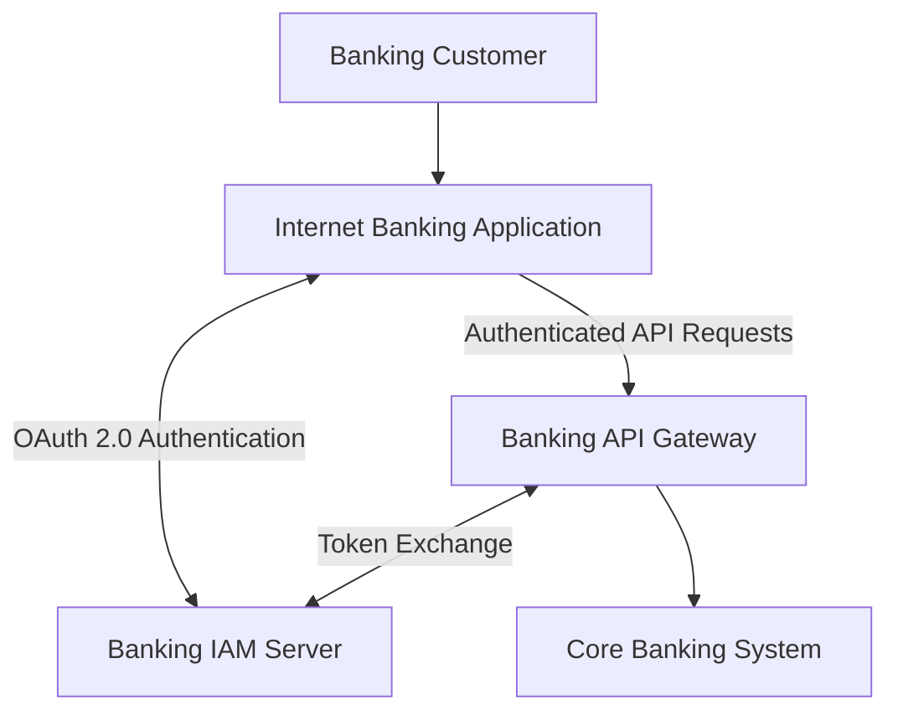

# Internet Banking Channel

<p align="center">
  
  
  
  
  
  
  
</p>

A secure, customer-facing digital banking application built with Spring Boot and Spring Security, providing customers with access to their banking accounts, balances, cards, transactions, and fund transfer services through a centralized Banking API Gateway.

## Overview

**Internet Banking** is the customer-facing digital banking channel of a modular banking ecosystem.

It provides an interface through which customers can access their banking information and perform supported banking operations without directly interacting with the underlying Core Banking System (CBS).

The application delegates customer authentication and authorization to the centralized Banking IAM Server and communicates with backend banking services through the Banking API Gateway.

This architecture keeps customer-facing functionality independent of the internal banking infrastructure while maintaining centralized identity management and controlled access to banking operations.

## Architecture



## Core Features

### Authentication & Security

- Customer authentication through the centralized Banking IAM Server.
- OAuth 2.0 Authorization Code Grant.
- Secure session management.
- OAuth 2.0 access-token handling.
- Centralized authorization through application-specific scopes.
- Secure communication with backend banking services through the API Gateway.

### Account Management

- View customer banking accounts.
- Retrieve account information.
- View available account balances.
- Access account-related information and supported banking products.

### Card Management

- View customer-associated debit and credit cards.
- Retrieve card information and status.
- Access supported card-related operations.
- PIN verification through the banking backend.

### Fund Transfers

- Initiate supported banking transfers.
- Submit transfer requests through the Banking API Gateway.
- Retrieve transfer and transaction information.
- Support transaction reversal operations where authorized.

### Transaction History

- Retrieve customer transaction history.
- Search and inspect banking transactions.
- Access transaction details through the banking backend.

### Banking Products & Information

- View available banking products.
- Retrieve supported currency information.
- Access relevant banking reference data.

## Technology Stack

| Component | Technology |
|---|---|
| Language | Java |
| Framework | Spring Boot |
| Security | Spring Security |
| Authentication | OAuth 2.0 / OpenID Connect integration |
| Authorization | OAuth 2.0 Scopes |
| Server-Side Rendering | Thymeleaf |
| Frontend | HTML, CSS, JavaScript |
| Build Tool | Gradle (Kotlin DSL) |
| Container Platform | Kubernetes / MicroK8s |

## Authentication Architecture

Internet Banking does not maintain an independent authentication infrastructure.

Instead, it delegates customer authentication to the Banking IAM Server.

### OAuth 2.0 Authorization Code Flow

The application uses the Authorization Code Grant to authenticate customers.

The authentication workflow is:

1. A customer accesses the Internet Banking application.
2. The application initiates authentication with the Banking IAM Server.
3. The customer authenticates through the IAM Server.
4. The IAM Server issues an authorization code.
5. Internet Banking exchanges the authorization code for an access token.
6. The application establishes the authenticated customer session.
7. Subsequent banking API requests are made using the authorized access token.

The centralized IAM architecture allows authentication policies and identity management to remain independent of the customer-facing application.

## Backend Integration

Internet Banking communicates with the Banking API Gateway rather than directly accessing the Core Banking System.

The gateway provides channel-specific API endpoints and handles downstream integration with the CBS.

### API Gateway Integration

Example API namespace:

```text
/api/v1/internet-banking/**
```

The application uses the gateway for supported banking operations, including:

- Customer account information.
- Account balance inquiries.
- Card information and PIN verification.
- Fund transfers.
- Transaction history and search.
- Transaction reversal.
- Banking products and currency information.

### Customer Identity

The application maintains the relationship between the authenticated IAM identity and the corresponding CBS customer identity.

This allows authenticated customers to access only their associated banking information and resources.

Customer identity resolution is handled at the application/service layer rather than relying on controller-level authentication principal injection.

## OAuth 2.0 Scopes

Internet Banking uses application-specific OAuth 2.0 scopes to represent permitted banking operations.

Examples include:

```text
ibanking.account.read
ibanking.balance.read
ibanking.card.read
ibanking.pin.verify
ibanking.currency.read
ibanking.product.read
ibanking.transfer
ibanking.reversal
ibanking.transaction.read
```

These scopes are evaluated as part of the centralized authorization architecture.

The Banking API Gateway subsequently exchanges the incoming Internet Banking access token for an appropriately scoped CBS access token when accessing downstream services.

This ensures that customer-facing permissions and backend service permissions remain logically separated.

## Security Architecture

The application follows a layered security approach:

- **Centralized Authentication:** Customer identity verification is delegated to the Banking IAM Server.
- **OAuth 2.0 Authorization:** Banking operations are protected using application-specific scopes.
- **Session Management:** Authenticated customer sessions are managed by the Internet Banking application.
- **Gateway-Based Integration:** Backend banking APIs are accessed through the Banking API Gateway.
- **Token Exchange:** Downstream access is delegated to the gateway using the IAM Server.
- **Customer-Level Authorization:** Banking resources are associated with the authenticated customer's identity.

## Deployment Architecture

Internet Banking is designed to run as an independent application within a Kubernetes environment.

It communicates with the Banking IAM Server and Banking API Gateway using their configured service endpoints.

Example service endpoints:

```text
Banking IAM Server:
http://banking-iam-server.banking-iam-staging.svc.cluster.local:8000

Banking API Gateway:
http://banking-api-gateway.channel-services-staging.svc.cluster.local:8080
```

Actual service addresses should be configured according to the deployment environment.

### Networking

- Internet Banking can be exposed through an Ingress Controller or reverse proxy such as Nginx.
- IAM authentication endpoints must be reachable through their configured issuer URL.
- API Gateway communication can use internal Kubernetes service discovery.
- Internal banking services remain isolated from direct public access.

## Configuration

The application uses Spring Boot externalized configuration.

Typical configuration areas include:

| Configuration | Description |
|---|---|
| Server | Application port and server settings |
| IAM | Authorization server issuer and client configuration |
| OAuth 2.0 | Client registration and authorized grant configuration |
| Gateway | Banking API Gateway base URL |
| Session | Application session and cookie configuration |
| Security | Authentication and authorization policies |
| Logging | Application and security logging |

Sensitive configuration, including client secrets and credentials, must be provided through environment-specific configuration or Kubernetes Secrets.

## Running Locally

### Prerequisites

- JDK 25
- Gradle
- Running Banking IAM Server
- Running Banking API Gateway
- Accessible Core Banking System

### Clone the Repository

```bash
git clone https://github.com/YOUR_USERNAME/internet-banking.git

cd internet-banking
```

### Build

```bash
./gradlew clean build
```

### Run

```bash
./gradlew bootRun
```

The application starts on the configured server port.

Ensure that the IAM Server issuer URL and Banking API Gateway base URL are correctly configured before starting the application.

## Project Structure

The application follows a layered Spring Boot architecture.

A representative project structure:

```text
src/
└── main/
    ├── java/
    │   └── ...
    │       ├── config/
    │       ├── controller/
    │       ├── security/
    │       ├── service/
    │       ├── client/
    │       └── model/
    │
    ├── resources/
    │   ├── templates/
    │   ├── static/
    │   └── application.yml

build.gradle.kts
settings.gradle.kts
gradlew
README.md
```

The exact package organization may evolve as additional banking features are introduced.

## Part of a Larger Banking Ecosystem

Internet Banking is one of the customer-facing channels in a broader modular banking platform.

| Component | Responsibility |
|---|---|
| Core Banking System | Core banking operations and financial transactions |
| Banking IAM Server | Identity management, authentication, authorization, and token issuance |
| Banking API Gateway | Centralized API routing and downstream security enforcement |
| Internet Banking | Customer-facing digital banking channel |
| ATM/POS Switch | ATM and POS transaction processing |

Together, these components demonstrate a modular banking architecture with centralized identity management, channel-specific API contracts, and secure backend integration.

## Disclaimer

This project is intended for educational, architectural demonstration, and portfolio purposes.

It is not a production-ready Internet Banking platform. Real-world deployment would require additional security controls, transaction authorization mechanisms, fraud detection, regulatory compliance, penetration testing, operational monitoring, and security hardening.
