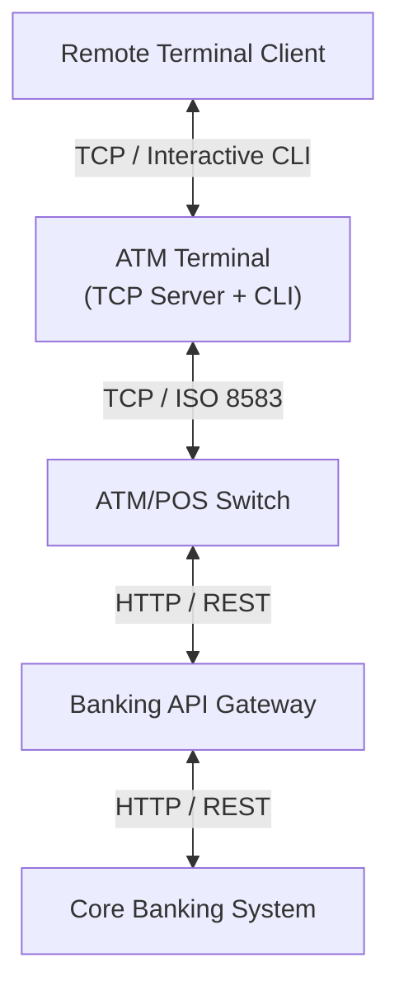

# ATM Terminal

<p align="center">
  
  
  
  
  
  
  
</p>

A lightweight ATM terminal simulator built with Java 25 and Spring Boot 4. It communicates with an ATM/POS transaction switch over TCP using ISO 8583 messages, simulating the core transaction flows of a physical ATM.

`atm-terminal` is part of a demonstration banking ecosystem that includes a Core Banking System (CBS), an ATM/POS Switch, a Banking API Gateway, and an Identity and Access Management (IAM) server.

## Overview

The application simulates a physical ATM through an interactive command-line interface (CLI).

Unlike a conventional locally executed CLI application, the ATM terminal exposes a TCP server that allows users to connect remotely using terminal clients such as PuTTY or Telnet.

Each connected client receives an interactive ATM session. The application enforces exclusive session access: only one client can operate the ATM at a time. Additional connections are rejected while another session is active.

The terminal communicates with the ATM/POS Switch using ISO 8583 messages. It does not interact directly with the Core Banking System or Banking API Gateway.

## Architecture



The ATM terminal consists of two independent network listeners:

| Listener            | Port | Responsibility                                       |
| ------------------- | ---: | ---------------------------------------------------- |
| ATM TCP Server      | 2323 | Accepts remote terminal connections                  |
| Health Check Server | 8080 | Exposes application liveness and readiness endpoints |

The health-check server is independent of the ATM session-management mechanism. Kubernetes health probes therefore do not consume ATM sessions or interfere with active clients.

## Features

- Interactive remote ATM command-line interface.
- TCP-based access from terminal clients.
- Exclusive ATM session management.
- Concurrent connection handling using Java virtual threads.
- Automatic session lease release after client disconnection.
- ATM card and PIN-based authentication.
- PIN verification through ISO 8583 transaction messages.
- Account balance inquiry.
- Cash withdrawal with amount validation.
- Configurable terminal identification.
- TCP communication with the ATM/POS Switch.
- ISO 8583 message construction and response parsing.
- Configurable connection and read timeouts.
- Dedicated HTTP health-check server.
- Kubernetes liveness and readiness probes.
- Graceful server shutdown and resource cleanup.

## Technology Stack

| Technology            | Purpose                                        |
| --------------------- | ---------------------------------------------- |
| Java 25               | Programming language                           |
| Spring Boot 4         | Application framework and lifecycle management |
| Gradle Kotlin DSL     | Build automation                               |
| jPOS 3                | ISO 8583 message processing                    |
| TCP Sockets           | Terminal and switch communication              |
| Java Virtual Threads  | Concurrent client connection handling          |
| Spring SmartLifecycle | Managed server startup and shutdown            |
| Kubernetes            | Container orchestration and deployment         |

## Terminal Session Management

The ATM terminal supports multiple incoming TCP connections but allows only one active ATM session at a time.

A session lease is acquired when a client successfully connects. If another client attempts to connect while the ATM is occupied, the connection is rejected with an appropriate message.

The lease is released when the active session ends, including when:

- The user exits the ATM session.
- The client closes the terminal connection.
- The client disconnects unexpectedly.
- An exception terminates the session.

The lease is managed using a resource-safe lifecycle so that the ATM becomes available again after the session terminates.

## Communication Protocol

The terminal communicates with the ATM/POS Switch using an ISO 8583:1987-based message profile.

### Transport Layer

| Property             | Configuration                      |
| -------------------- | ---------------------------------- |
| Protocol             | TCP                                |
| Message framing      | 2-byte big-endian length prefix    |
| Maximum message size | 8,192 bytes                        |
| Connection model     | One TCP connection per transaction |
| Connection timeout   | Configurable                       |
| Read timeout         | Configurable                       |

The remote terminal client maintains its connection to the ATM terminal for the duration of its interactive session. The ATM terminal establishes communication with the switch when processing transactions.

### Supported Transaction Types

| Transaction      | Request MTI | Response MTI | Description                |
| ---------------- | ----------- | ------------ | -------------------------- |
| PIN Verification | `0100`      | `0110`       | Validates card PIN         |
| Balance Inquiry  | `0200`      | `0210`       | Retrieves account balance  |
| Cash Withdrawal  | `0200`      | `0210`       | Requests a cash withdrawal |

The terminal uses the configured ISO 8583 packager to construct outgoing messages and parse incoming responses.

### Common Data Elements

| Data Element | Description                      |
| ------------ | -------------------------------- |
| DE2          | Primary Account Number (PAN)     |
| DE3          | Processing Code                  |
| DE4          | Transaction Amount               |
| DE7          | Transmission Date and Time       |
| DE11         | System Trace Audit Number (STAN) |
| DE37         | Retrieval Reference Number       |
| DE39         | Response Code                    |
| DE41         | Terminal Identification          |
| DE49         | Transaction Currency Code        |
| DE52         | PIN Data                         |
| DE54         | Additional Amounts               |
| DE90         | Original Data Elements           |

The exact fields depend on the transaction type.

## Health Checks

The application provides a lightweight health-check HTTP server implemented using Java's built-in networking APIs.

It does not require Spring Boot Actuator or Spring Web MVC.

### Available Endpoints

| Endpoint            | Purpose                                                        | Expected Response                     |
| ------------------- | -------------------------------------------------------------- | ------------------------------------- |
| `/health/liveness`  | Checks whether the health-check server is alive                | `200 OK`                              |
| `/health/readiness` | Checks whether the ATM terminal is ready to accept connections | `200 OK` or `503 Service Unavailable` |

Readiness is initially false and becomes true after the ATM TCP listener successfully starts. It returns to false during shutdown.

The health-check server is managed through Spring's `SmartLifecycle`, allowing its startup and shutdown to participate in the Spring application lifecycle.

## Getting Started

### Prerequisites

- JDK 25
- Gradle (or use the included Gradle Wrapper)
- A running instance of [atm-pos-switch](https://github.com/limolead/atm-pos-switch)

### Configuration

Configure the terminal in `src/main/resources/application.yml`.

Example:

```yaml
atm:
  terminal-id: ATM00001

  switch:
    host: localhost
    port: 15000
    connect-timeout: 5000
    read-timeout: 30000

  terminal:
    health:
      port: 8080
```

Adjust the switch host and port according to your deployment environment.

The terminal ID must be registered or recognized by the ATM/POS Switch.

### Running the Application

Clone the repository:

```bash
git clone https://github.com/limolead/atm-terminal.git
cd atm-terminal
```

Build the application:

```bash
./gradlew clean build
```

Run the application:

```bash
./gradlew bootRun
```

On Windows:

```powershell
gradlew.bat bootRun
```

Once started, the application listens for remote terminal connections on port `2323` and health checks on port `8080`.

### Connecting to the ATM

You can connect using any compatible TCP terminal client.

For example, using Telnet:

```bash
telnet <SERVER-IP> 2323
```

Or, when deployed to Kubernetes through the configured NodePort:

```bash
telnet <NODE-IP> 32000
```

The terminal displays the ATM interface after a successful connection.

Only one client can operate the ATM at a time. Additional clients receive an ATM-in-use notification.

## Docker

The application exposes two container ports:

```dockerfile
EXPOSE 2323 8080
```

| Port | Purpose                         |
| ---- | ------------------------------- |
| 2323 | Remote ATM terminal connections |
| 8080 | Health-check HTTP endpoints     |

Both ports are available inside the container. External exposure is controlled by the container runtime or Kubernetes Service configuration.

## Kubernetes Deployment

The ATM terminal is designed to run in Kubernetes as an independently deployable application.

The current deployment uses:

- Namespace: `banking-channel-apps-staging`
- ATM TCP listener: `2323`
- Health-check listener: `8080`
- Service type: `NodePort`
- NodePort: `32000`

### Service Configuration

The Kubernetes Service exposes only the ATM TCP listener.

```yaml
apiVersion: v1
kind: Service
metadata:
  name: atm-terminal
  namespace: banking-channel-apps-staging
spec:
  type: NodePort
  selector:
    app: atm-terminal
  ports:
    - name: atm-tcp
      protocol: TCP
      port: 2323
      targetPort: 2323
      nodePort: 32000
```

The health-check port is not exposed through the Service. Kubernetes accesses it directly through the Pod network.

### Health Probes

The Deployment uses HTTP probes against the dedicated health-check server:

```yaml
livenessProbe:
  httpGet:
    path: /health/liveness
    port: health-http
  initialDelaySeconds: 15
  periodSeconds: 20

readinessProbe:
  httpGet:
    path: /health/readiness
    port: health-http
  initialDelaySeconds: 10
  periodSeconds: 10
```

This separation prevents Kubernetes health probes from opening connections to the ATM TCP listener and interfering with session management.

### Connecting to a Deployed ATM

Once deployed, connect to the ATM using the IP address of a Kubernetes node and the configured NodePort:

```bash
telnet <NODE-IP> 32000
```

No Kubernetes CLI or container access is required by the terminal user.

## Using the Terminal

Once connected, the application presents an interactive ATM command-line interface.

The typical interaction flow is:

1. Enter the ATM card number (PAN).
2. Enter the card PIN.
3. The terminal sends a PIN verification request to the switch.
4. Upon successful authentication, the transaction menu becomes available.
5. Select a transaction:
   - Balance Inquiry
   - Cash Withdrawal
   - Exit

The terminal processes the switch response and displays the appropriate transaction result.

## Project Ecosystem

This application is one component of a broader banking demonstration project.

| Component           | Responsibility                                        |
| ------------------- | ----------------------------------------------------- |
| ATM Terminal        | Simulates physical ATM interactions                   |
| ATM/POS Switch      | Processes ISO 8583 transactions                       |
| Banking API Gateway | Provides a unified API entry point                    |
| IAM Server          | Handles authentication and authorization              |
| Core Banking System | Manages accounts, balances and financial transactions |

Each component is independently deployable and communicates through well-defined interfaces.

## Project Status

This project is being developed as part of an end-to-end banking technology demonstration.

The ATM terminal currently supports the core ATM transaction lifecycle:

- Card authentication and PIN verification.
- Account balance inquiry.
- Cash withdrawal.
- Remote TCP-based terminal access.
- Exclusive session management.
- Kubernetes health monitoring and deployment.

Additional capabilities and improvements will be introduced as the banking ecosystem evolves.

## License

This project is intended for educational, demonstration and software architecture showcase purposes.
