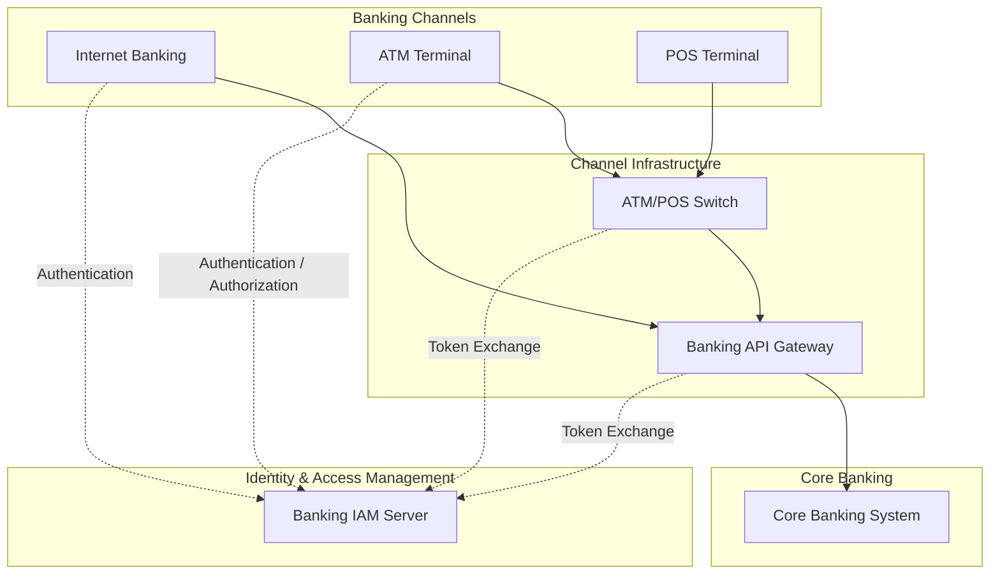

# Banking Platform

<p align="center">
  <strong>A mini Banking Platform simulation with Core Banking, Internet Banking Channel, ATM/POS Switching, and Centralized Identity & Access Management.</strong>
</p>

<p align="center">
  
  
  
  
  
  
  
  
  
  
</p>

---

## Overview

**Banking Platform** is a multi-application banking ecosystem designed to demonstrate the architecture and integration of modern banking systems.

The platform brings together several independently developed applications, each responsible for a specific banking domain or delivery channel. These applications work together to provide core banking capabilities, centralized authentication and authorization, API orchestration, internet banking, and ATM/POS transaction processing.

Rather than building a monolithic banking application, the platform follows a modular, service-oriented architecture in which individual components have clearly defined responsibilities and communicate through well-defined interfaces.

The project is primarily intended as an engineering showcase, exploring topics such as:

- Core banking system design and double-entry bookkeeping.
- Modular application architecture and domain separation.
- OAuth 2.0 and OpenID Connect-based authentication and authorization.
- API gateway architecture and token exchange.
- ATM/POS transaction processing using ISO 8583.
- Distributed application integration.
- Database design, transaction consistency, and concurrency control.
- Containerization and Kubernetes-based deployment.

## Architecture

The platform consists of six independently developed applications integrated into a single repository.

### High-level architecture



The architecture separates customer-facing channels, transaction processing infrastructure, identity management, and core banking operations.

Each component can be developed, maintained, and deployed independently.

### Application components

| Application | Responsibility |
|---|---|
| Core Banking System | Core banking operations, accounts, transactions, and ledger management. |
| Banking API Gateway | Centralized API routing, request orchestration, and security enforcement. |
| Banking IAM Server | Authentication, authorization, OAuth 2.0, and token management. |
| ATM/POS Switch | ATM/POS transaction routing and ISO 8583 message processing. |
| Internet Banking | Customer-facing internet banking services. |
| ATM Terminal | ATM terminal simulation and transaction interaction. |

## Applications

### 1. Core Banking System (CBS)

**Directory:** `apps/cbs`

The Core Banking System is the central banking engine responsible for maintaining banking records and executing financial operations.

It provides the fundamental banking capabilities consumed by other applications through its APIs.

Key areas include:

- Customer and branch management.
- Account and account product management.
- Account balances and transaction processing.
- Double-entry ledger and accounting operations.
- Deposits and withdrawals.
- Fund transfer and transaction reversal.
- Interest configuration, accrual, and posting.
- Fees and charges.
- Account holds and restrictions.
- Debit and credit card management.
- Transaction auditing and reconciliation.

The application follows a modular architecture using Spring Modulith, with domain-oriented module separation and dedicated database schemas.

**Repository:** [hossensyedriadh/cbs](https://github.com/hossensyedriadh/cbs)

### 2. Banking API Gateway

**Directory:** `apps/banking-api-gateway`

The Banking API Gateway acts as the central entry point for banking channel applications accessing core banking services.

It provides an abstraction layer between channel-specific applications and the underlying Core Banking System.

Key responsibilities include:

- API routing and request forwarding.
- Channel-specific route mapping.
- OAuth 2.0 resource server integration.
- Access token validation.
- Token exchange and delegated authorization.
- Scope mapping between channel applications and core banking APIs.
- Centralized API access control.
- Service-to-service communication.

The gateway helps keep channel applications decoupled from the internal API structure of the Core Banking System.

**Repository:** [hossensyedriadh/banking-api-gateway](https://github.com/hossensyedriadh/banking-api-gateway)

### 3. Banking Identity & Access Management (IAM) Server

**Directory:** `apps/banking-iam-server`

The Banking IAM Server provides centralized identity and access management for the banking ecosystem.

It is responsible for managing authentication, authorization, OAuth 2.0 clients, access tokens, and delegated access between applications.

Key responsibilities include:

- User authentication and authorization.
- OAuth 2.0 authorization server.
- OpenID Connect integration.
- Client registration and management.
- Access and refresh token management.
- Client credentials and authorization code grants.
- Token exchange.
- Audience management.
- Scope-based access control.
- Inter-application identity and authorization.

It establishes a centralized security infrastructure that allows different banking channels and backend services to authenticate and communicate securely.

**Repository:** [hossensyedriadh/banking-iam-server](https://github.com/hossensyedriadh/banking-iam-server)

### 4. ATM/POS Switch

**Directory:** `apps/atm-pos-switch`

The ATM/POS Switch is responsible for processing and routing financial transactions originating from ATM and POS terminals.

It acts as the transaction processing intermediary between terminal devices and the banking infrastructure.

Key responsibilities include:

- ISO 8583 message processing.
- TCP-based terminal communication.
- Transaction request routing.
- ATM/POS transaction handling.
- Balance inquiry.
- Cash withdrawal processing.
- PIN verification.
- Transaction reversal.
- Transaction response generation.
- Core banking integration.
- Service-to-service authentication.

The switch handles the communication and transaction processing requirements of ATM/POS channels while delegating actual banking operations to the Core Banking System.

**Repository:** [hossensyedriadh/atm-pos-switch](https://github.com/hossensyedriadh/atm-pos-switch)

### 5. Internet Banking

**Directory:** `apps/internet-banking`

Internet Banking provides the customer-facing digital banking channel.

It integrates with the Banking IAM Server for authentication and uses the Banking API Gateway to access banking services.

Key capabilities include:

- Customer authentication.
- Customer profile and account information.
- Account balance inquiry.
- Transaction history.
- Card information and management.
- PIN-related operations.
- Fund transfer.
- Transaction search.
- Banking product and currency information.
- Integration with centralized identity management.

The application demonstrates how a digital banking channel can consume core banking capabilities without directly coupling itself to the underlying Core Banking System.

**Repository:** [hossensyedriadh/internet-banking](https://github.com/hossensyedriadh/internet-banking)

### 6. ATM Terminal

**Directory:** `apps/atm-terminal`

The ATM Terminal is a standalone ATM client application developed to simulate interactions between an ATM device and the ATM/POS Switch.

It communicates with the switch using ISO 8583 messages over TCP.

Key capabilities include:

- ATM terminal identification.
- ISO 8583 message construction and parsing.
- TCP communication with the ATM/POS Switch.
- Balance inquiry.
- Cash withdrawal.
- PIN-based transaction authentication.
- Transaction response handling.
- Transaction reversal support.

The terminal provides a practical way to exercise the ATM transaction processing pipeline without requiring physical ATM hardware.

**Repository:** [hossensyedriadh/atm-terminal](https://github.com/hossensyedriadh/atm-terminal)

---

## Technology Stack

The platform uses technologies commonly found in enterprise banking and distributed backend systems.

| Category | Technologies |
|---|---|
| Programming Language | Java |
| Backend Framework | Spring Boot |
| Application Architecture | Spring Modulith, Service-oriented architecture |
| API Communication | REST APIs, HTTP |
| Financial Messaging | ISO 8583 |
| Authentication | OAuth 2.0, OpenID Connect |
| Database | PostgreSQL |
| Caching and Distributed Coordination | Redis |
| Messaging | Apache Kafka |
| Build Automation | Gradle, Kotlin DSL |
| Containerization | Docker |
| Orchestration | Kubernetes, MicroK8s |
| CI/CD | Jenkins |
| API Documentation | OpenAPI, Swagger UI |

*Technology usage varies between applications. Refer to the individual application README files for their exact dependencies and implementation details.*

## Repository Structure

The repository consolidates six independently maintained Git repositories into a single monorepo.

```text
banking/
│
├── apps/
│   │
│   ├── cbs/
│   │   └── Core Banking System
│   │
│   ├── banking-api-gateway/
│   │   └── Banking API Gateway
│   │
│   ├── banking-iam-server/
│   │   └── Identity & Access Management
│   │
│   ├── atm-pos-switch/
│   │   └── ATM/POS Transaction Switch
│   │
│   ├── internet-banking/
│   │   └── Internet Banking Application
│   │
│   └── atm-terminal/
│       └── ATM Terminal Simulator
│
├── README.md
└── .gitignore
```

Each application retains its own build configuration, source code, dependencies, and application-specific documentation.

## Getting Started

### Prerequisites

The following tools are recommended for working with the platform:

- Git
- Java Development Kit (JDK) 25
- Gradle (or the included Gradle Wrapper)
- Docker
- PostgreSQL
- Redis

Additional dependencies may be required depending on the application being executed.

### Cloning the Repository

```bash
git clone https://github.com/hossensyedriadh/banking.git

cd banking
```

### Building Individual Applications

Each application is independently buildable.

Navigate to the application directory:

```bash
cd apps/cbs
```

Build using its Gradle Wrapper:

```bash
./gradlew clean build
```

On Windows:

```powershell
.\gradlew.bat clean build
```

Repeat the process for the other application directories.

### Running Applications

Each application has its own configuration, environment variables, database requirements, and runtime dependencies.

Refer to its individual README for detailed setup and execution instructions.

**Note:** The complete banking ecosystem requires multiple applications and infrastructure services to be running with their corresponding configurations. Individual applications can also be explored and executed independently where their dependencies permit.

## Development and Repository Management

Although the applications are consolidated into a single repository, each application is maintained as an independent development project.

The original repositories remain the primary development repositories:

| Application | Development Repository |
|---|---|
| CBS | [cbs](https://github.com/hossensyedriadh/cbs) |
| API Gateway | [banking-api-gateway](https://github.com/hossensyedriadh/banking-api-gateway) |
| IAM Server | [banking-iam-server](https://github.com/hossensyedriadh/banking-iam-server) |
| ATM/POS Switch | [atm-pos-switch](https://github.com/hossensyedriadh/atm-pos-switch) |
| Internet Banking | [internet-banking](https://github.com/hossensyedriadh/internet-banking) |
| ATM Terminal | [atm-terminal](https://github.com/hossensyedriadh/atm-terminal) |

### Git History Preservation

The monorepo uses Git subtree integration to preserve the original commit histories of all six application repositories.

This means the repository contains the actual historical commits of each application rather than simply importing their latest source code.

### Synchronization Strategy

The synchronization workflow is intentionally one-directional:

```text
Individual Application Repository
              |
              |  Development and commits
              |
              v
       Individual Repository
              |
              |  git subtree pull
              v
         Banking Monorepo
```

All application development takes place in the respective standalone repositories.

When updates are available, the corresponding application history is pulled into the monorepo using `git subtree pull`.

For example, to synchronize the Core Banking System:

```bash
git subtree pull \
  --prefix=apps/cbs \
  https://github.com/hossensyedriadh/cbs.git \
  main
```

After synchronizing the required applications, publish the updated monorepo:

```bash
git push origin main
```

The monorepo is maintained as a consolidated representation of the individual application repositories. Changes are not pushed back from the monorepo into the standalone repositories.

## Project Goals

This project is an ongoing exploration of software architecture and engineering practices in the banking domain.

The primary goals are:

- Build a functional, modular core banking application.
- Explore the design of banking transaction processing systems.
- Implement centralized identity and access management.
- Demonstrate secure communication between independently deployed services.
- Explore ISO 8583-based financial transaction processing.
- Build realistic digital banking and ATM transaction channels.
- Practice database architecture, transaction consistency, and concurrency management.
- Explore containerized deployment and orchestration.
- Maintain clean separation of responsibilities across banking domains.

## Disclaimer

This project is developed for educational, experimental, and software engineering demonstration purposes.

It is **not a production-ready banking platform** and has not been certified for real-world financial operations.

It should not be used to process actual customer funds, store real payment credentials, or handle production banking transactions.

Production banking systems require extensive security reviews, regulatory compliance, operational controls, independent audits, high availability, disaster recovery, and formal certification.

## License

Refer to the repository's [LICENSE](LICENSE) file for licensing information.

---

<p align="center">
  <strong>Built with Java and Spring Boot.</strong>
  <br>
  Exploring the engineering behind modern banking systems.
</p>
