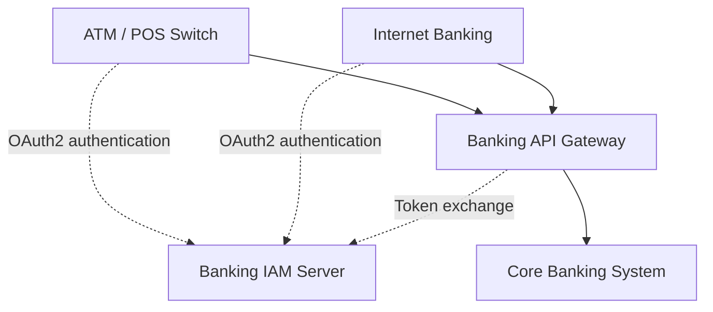

# Banking API Gateway

A secure, multi-channel API gateway for a modular Core Banking System (CBS), providing centralized API routing, access-token validation, authorization enforcement, and secure service-to-service communication for banking channels.

## Overview

**Banking API Gateway** acts as the central entry point between banking channels and the Core Banking System.

It provides channel-specific API endpoints while internally translating and routing requests to the appropriate CBS services. This allows different banking channels to expose their own API contracts without coupling channel applications directly to the internal CBS API structure.

The gateway also integrates with a centralized OAuth 2.0 authorization server to handle access-token validation and token exchange, enabling secure service-to-service communication across the banking ecosystem.

## Architecture



### Core Responsibilities

- **Centralized API Entry Point:** Provides a unified entry point for banking channel applications.
- **Channel-Specific Routing:** Maps channel-specific API endpoints to their corresponding CBS endpoints.
- **OAuth 2.0 Security:** Validates incoming access tokens and enforces authorization policies.
- **OAuth 2.0 Token Exchange:** Exchanges channel-specific access tokens for downstream service tokens with appropriate audiences and scopes.
- **Service-to-Service Communication:** Securely communicates with downstream banking services.
- **API Documentation:** Provides centralized access to downstream CBS API documentation through Swagger UI.

## Technology Stack

| Component | Technology |
|---|---|
| Language | Java |
| Framework | Spring Boot |
| API Gateway | Spring Cloud Gateway |
| Gateway Runtime | Spring WebFlux |
| Authentication | OAuth 2.0 |
| Authorization Server | Spring Authorization Server |
| API Documentation | Springdoc OpenAPI / Swagger UI |
| Build Tool | Gradle (Kotlin DSL) |
| Container Platform | Kubernetes / MicroK8s |

## Gateway Routing

The gateway maintains separate routing configurations for different banking channels.

Instead of exposing internal CBS endpoints directly, it provides channel-specific API contracts and translates incoming requests into the appropriate downstream CBS requests.

### Internet Banking

Internet Banking uses its own API namespace:

```text
/api/v1/internet-banking/**
```

These endpoints are mapped to their corresponding CBS operations.

### ATM / POS Switch

ATM/POS operations use a separate API namespace:

```text
/api/v1/atm-switch/**
```

This allows the ATM/POS switch to communicate with the banking backend through a dedicated set of gateway routes.

### Routing Design

The routing architecture provides several benefits:

- Banking channels remain independent of internal CBS API structures.
- Different channels can expose different API contracts for the same underlying banking operation.
- Authorization policies can be enforced according to channel requirements.
- Downstream API changes can be isolated from channel applications.
- New banking channels can be integrated without requiring direct CBS exposure.

## Security Architecture

Security is based on OAuth 2.0 with centralized identity and access management.

The gateway integrates with the Banking IAM Server to authenticate incoming requests and authorize downstream communication.

### OAuth 2.0 Clients

The ecosystem uses separate OAuth 2.0 clients for different applications:

| Client ID | Responsibility |
|---|---|
| `internet-banking` | Internet Banking application |
| `atm-pos-switch` | ATM/POS Switch |
| `banking-api-gateway` | API Gateway downstream communication |

### Token Exchange

The gateway supports OAuth 2.0 Token Exchange to obtain appropriate downstream access tokens.

For example:

1. An Internet Banking application obtains an access token from the IAM Server.
2. It sends an authenticated request to the API Gateway.
3. The gateway validates the incoming access token.
4. The gateway exchanges the incoming token for a downstream CBS access token.
5. The IAM Server issues a token with the appropriate audience and authorized scopes.
6. The gateway forwards the request to the CBS using the exchanged token.

The same principle applies to ATM/POS communication.

This provides:

- Audience-specific access tokens.
- Scope-based authorization.
- Separation of channel and downstream permissions.
- Controlled service-to-service access.
- Reduced exposure of internal banking services.

## API Documentation

The gateway provides centralized access to Core Banking System API documentation.

### Swagger UI

The public Swagger UI endpoint is:

```text
/cbs/docs/swagger-ui/index.html
```

For local development:

```text
http://localhost:8080/cbs/docs/swagger-ui/index.html
```

### OpenAPI Specification

The CBS OpenAPI specification is accessible through:

```text
/cbs/docs/v3/api-docs
```

The gateway transparently routes documentation requests to the downstream CBS documentation endpoints.

This allows developers to explore CBS APIs without accessing the internal CBS service directly.

## Deployment Architecture

The system is designed to run in a Kubernetes environment.

The gateway communicates with internal banking services using Kubernetes service discovery.

An example internal CBS service address:

```text
http://cbs.banking-cbs-staging.svc.cluster.local:8080
```

### Networking

The intended networking architecture separates internal banking services from externally accessible entry points.

- **Banking API Gateway:** Exposes the banking API entry point.
- **Core Banking System:** Internal ClusterIP service.
- **Banking IAM Server:** Internal ClusterIP service, with external access provided through an appropriate ingress or reverse proxy when required.
- **ATM/POS Switch:** Communicates with the gateway through the designated internal or external network entry point.

External access can be managed through Kubernetes Ingress or a reverse proxy such as Nginx.

## Configuration

The gateway uses Spring Boot externalized configuration.

Environment-specific properties should be supplied through application configuration, environment variables, or Kubernetes ConfigMaps and Secrets.

Typical configuration areas include:

| Configuration | Description |
|---|---|
| Server | HTTP server port and application settings |
| CBS | Downstream Core Banking System base URL |
| IAM | OAuth 2.0 authorization server configuration |
| Security | JWT validation and token exchange settings |
| Gateway Routes | Channel-specific route definitions |
| Logging | Application and gateway logging |

**Important:** Credentials, client secrets, signing keys, and other sensitive configuration must never be committed to source control.

## Running Locally

### Prerequisites

- JDK 25
- Gradle
- Access to a running Banking IAM Server
- Access to a running Core Banking System

### Clone the Repository

```bash
git clone https://github.com/YOUR_USERNAME/banking-api-gateway.git

cd banking-api-gateway
```

### Build

```bash
./gradlew clean build
```

### Run

```bash
./gradlew bootRun
```

The gateway will start using the configured application port.

Make sure the IAM Server and CBS service URLs are configured correctly before starting the application.

## Project Structure

The application follows a modular Spring Boot configuration approach.

A typical organization of the codebase includes:

```text
src/
└── main/
    ├── java/
    │   └── ...
    │       ├── config/
    │       ├── security/
    │       ├── routing/
    │       └── service/
    │
    └── resources/
        └── application.yml

build.gradle.kts
settings.gradle.kts
gradlew
README.md
```

The exact package organization may evolve as the gateway grows.

## Design Principles

The project follows these architectural principles:

- **Separation of Concerns:** Channel applications, the gateway, IAM, and CBS have distinct responsibilities.
- **API Abstraction:** Banking channels consume channel-specific APIs rather than internal CBS endpoints.
- **Centralized Security:** Authentication and authorization are managed through a centralized IAM service.
- **Least Privilege:** Downstream access is restricted through audience and scope-based authorization.
- **Service Isolation:** Internal banking services are not unnecessarily exposed to external networks.
- **Extensibility:** Additional banking channels can be integrated through dedicated routing and authorization configurations.

## Part of a Larger Banking Ecosystem

Banking API Gateway is one component of a broader banking platform consisting of:

| Component | Responsibility |
|---|---|
| Core Banking System | Core banking operations and financial transactions |
| Banking IAM Server | Identity management, authentication, authorization, and OAuth 2.0 token issuance |
| Banking API Gateway | Centralized API routing, security enforcement, and downstream integration |
| Internet Banking | Customer-facing digital banking channel |
| ATM/POS Switch | ATM and POS transaction processing |

Together, these components demonstrate a modular banking architecture with centralized identity management, channel isolation, and secure service-to-service communication.

## Disclaimer

This project is intended for educational, architectural demonstration, and portfolio purposes.

It is not a production-ready banking platform. Real-world deployment would require additional security controls, compliance validation, operational hardening, resilience testing, and integration with certified banking infrastructure.

