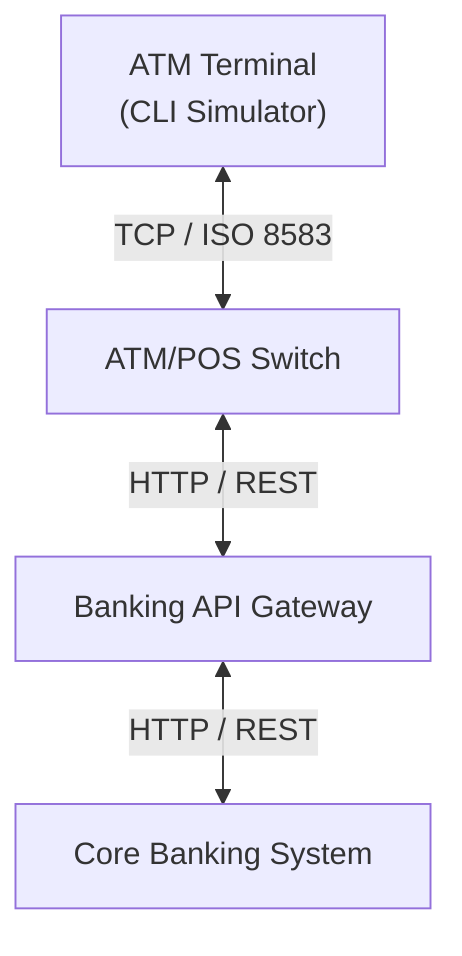

# ATM Terminal

<p align="center">
  
  
  
  
  
  
</p>

A lightweight ATM terminal simulator built with Java and Spring Boot. It communicates with an ATM/POS transaction switch over TCP using ISO 8583 messages, simulating the core transaction flows of a physical ATM.

`atm-terminal` is part of a demonstration banking ecosystem that includes a Core Banking System (CBS), an ATM/POS Switch, an API Gateway, and an Identity and Access Management (IAM) server.

## Overview

The application simulates an ATM terminal through an interactive command-line interface (CLI).

Users can interact with the terminal to authenticate using their card credentials, check their account balance, and perform cash withdrawal transactions.

Instead of communicating directly with the Core Banking System, the terminal sends ISO 8583 messages to the ATM/POS Switch. The switch handles transaction processing and communicates with the appropriate banking services.

## Architecture



The ATM terminal communicates exclusively with the ATM/POS Switch through a TCP connection. It does not interact directly with the CBS or API Gateway.

## Features

- Interactive command-line ATM interface.
- ATM card and PIN-based authentication.
- PIN verification through ISO 8583 transaction messages.
- Account balance inquiry.
- Cash withdrawal with amount validation.
- Configurable terminal identification.
- TCP communication with the ATM/POS Switch.
- ISO 8583 message construction and response parsing.
- Configurable connection and read timeouts.

## Technology Stack

| Technology | Purpose |
|---|---|
| Java 25 | Programming language |
| Spring Boot 4 | Application framework |
| Gradle Kotlin DSL | Build automation |
| jPOS 3 | ISO 8583 message processing |
| TCP Sockets | Terminal-to-switch communication |

## Communication Protocol

The terminal communicates with the switch using an ISO 8583:1987-based message profile.

### Transport Layer

- Protocol: TCP
- Message framing: 2-byte big-endian length prefix
- Maximum message size: 8,192 bytes
- Connection model: One TCP connection per transaction
- Configurable connection and read timeouts

### Supported Transaction Types

| Transaction | Request MTI | Response MTI | Description |
|---|---|---|---|
| PIN Verification | `0100` | `0110` | Validates card PIN |
| Balance Inquiry | `0200` | `0210` | Retrieves account balance |
| Cash Withdrawal | `0200` | `0210` | Requests a cash withdrawal |

The terminal uses the configured ISO 8583 packager to construct outgoing messages and parse incoming responses.

### Common Data Elements

The ISO 8583 messages use relevant data elements, including:

| Data Element | Description |
|---|---|
| DE2 | Primary Account Number (PAN) |
| DE3 | Processing Code |
| DE4 | Transaction Amount |
| DE7 | Transmission Date and Time |
| DE11 | System Trace Audit Number (STAN) |
| DE37 | Retrieval Reference Number |
| DE39 | Response Code |
| DE41 | Terminal Identification |
| DE49 | Transaction Currency Code |
| DE52 | PIN Data |
| DE54 | Additional Amounts |
| DE90 | Original Data Elements |

The exact fields depend on the transaction type.

## Getting Started

### Prerequisites

- JDK 25
- Gradle (or use the included Gradle Wrapper)
- A running instance of [atm-pos-switch](https://github.com/limolead/atm-pos-switch)

### Configuration

Configure the terminal in `src/main/resources/application.yml`.

Example:

```yaml
atm:
  terminal-id: ATM00001

  switch:
    host: localhost
    port: 15000
    connect-timeout: 5000
    read-timeout: 30000
```

Adjust the switch host and port according to your deployment environment.

The terminal ID must be registered or recognized by the ATM/POS Switch.

### Running the Application

Clone the repository:

```bash
git clone https://github.com/limolead/atm-terminal.git
cd atm-terminal
```

Build the application:

```bash
./gradlew clean build
```

Run the application:

```bash
./gradlew bootRun
```

On Windows:

```powershell
gradlew.bat bootRun
```

Make sure the ATM/POS Switch is running and reachable before starting a transaction.

## Using the Terminal

Once started, the application presents an interactive command-line interface.

The typical interaction flow is:

1. Enter the ATM card number (PAN).
2. Enter the card PIN.
3. The terminal sends a PIN verification request to the switch.
4. Upon successful authentication, the transaction menu becomes available.
5. Select a transaction:
   - Balance Inquiry
   - Cash Withdrawal
   - Exit

The terminal processes the switch response and displays the appropriate transaction result.

## Project Ecosystem

This application is one component of a broader banking demonstration project.

| Component | Responsibility |
|---|---|
| ATM Terminal | Simulates physical ATM interactions |
| ATM/POS Switch | Processes ISO 8583 transactions |
| Banking API Gateway | Provides a unified API entry point |
| IAM Server | Handles authentication and authorization |
| Core Banking System | Manages accounts, balances and financial transactions |

Each component is independently deployable and communicates through well-defined interfaces.

## Project Status

This project is being developed as part of an end-to-end banking technology demonstration.

The initial focus is on implementing the ATM transaction lifecycle, including card authentication, balance inquiry and cash withdrawal.

Additional capabilities and improvements will be introduced as the banking ecosystem evolves.

## License

This project is intended for educational, demonstration and software architecture showcase purposes.
