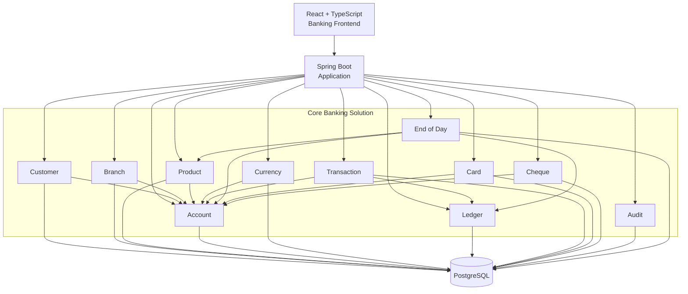
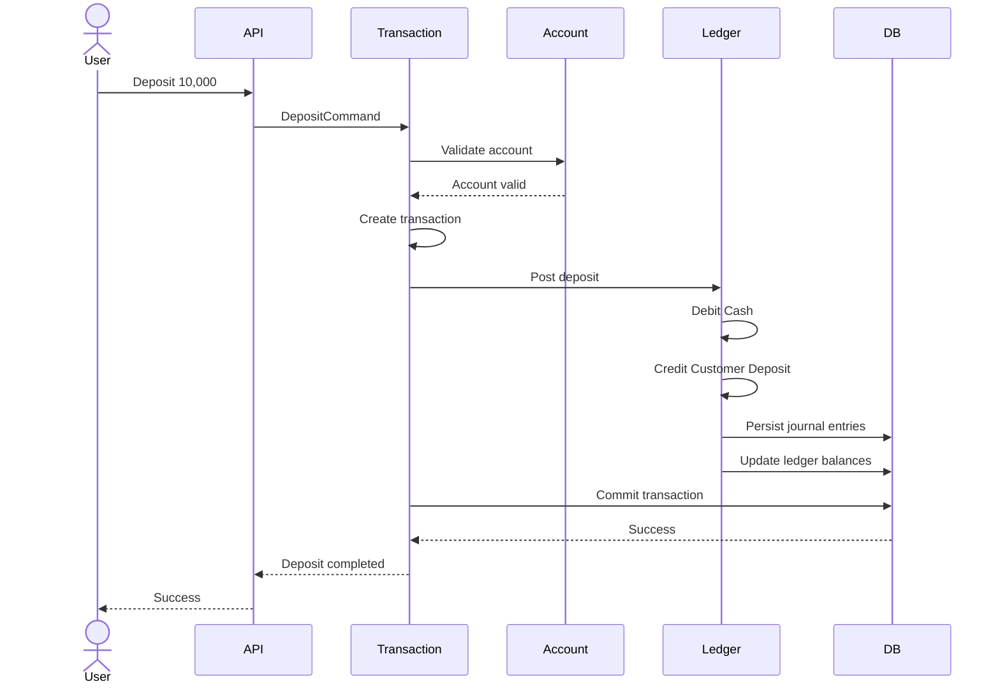
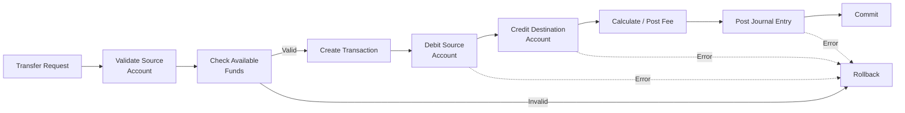
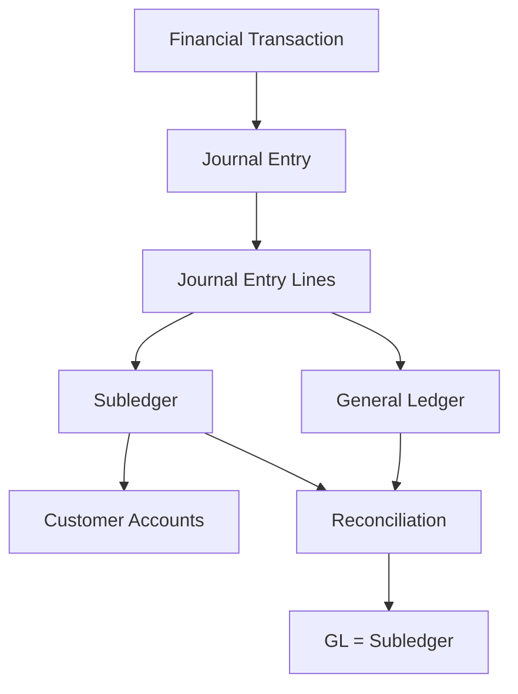
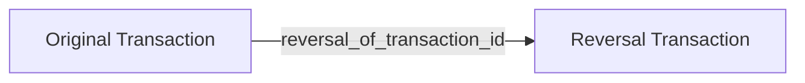
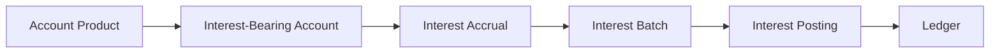
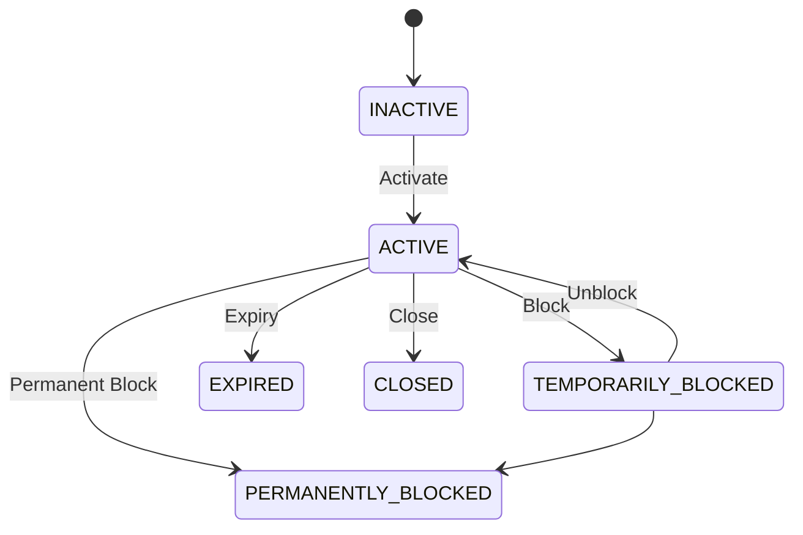
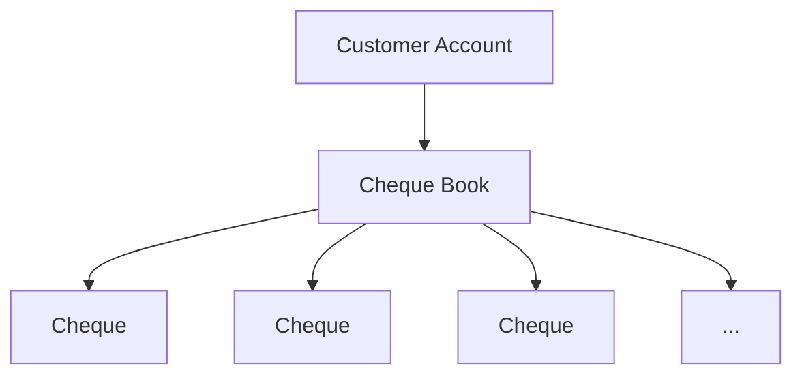
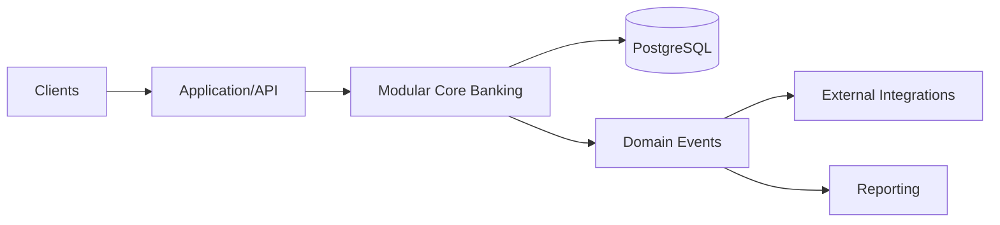

# Core Banking Solution

<p align="center">
  <strong>A production-inspired Core Banking Solution built with Java, Spring Boot, and Spring Modulith.</strong>
</p>

<p align="center">
  <a href="#architecture">Architecture</a> •
  <a href="#features">Features</a> •
  <a href="#accounting-model">Accounting</a> •
  <a href="#screenshots">Screenshots</a> •
  <a href="#roadmap">Roadmap</a>
</p>

<p align="center">
  
  
  
  
  

[//]: # (  )
</p>

<p align="center">
  
  
  
  
  
</p>

<p align="center">
    
</p>

---

## Overview

This project is a **production-inspired Core Banking Solution (CBS)** designed to explore the architecture, accounting
principles, and transactional behavior behind modern banking software.

Rather than treating banking as a collection of CRUD operations, the system models concepts such as:

* Customers and branches
* Account products
* Customer accounts
* Currencies
* General ledger and subledger
* Double-entry accounting
* Deposits, withdrawals, and transfers
* Transaction reversals
* Interest accrual and posting
* Account holds
* Payment cards
* Cheque books
* Auditability
* Financial reconciliation
* End of Day processing

The backend is implemented as a **Spring Modulith modular monolith**, providing strong domain boundaries while avoiding
the distributed-system complexity of microservices.

The frontend provides a banking-oriented interface for interacting with the system and demonstrating the underlying
domain model.

> **This is a portfolio and learning project, not production banking software.**

---

# Architecture

The system uses a **modular monolith architecture**.

The application is deployed as a single Spring Boot application, but internally consists of independently bounded
business modules.



---

# Why a Modular Monolith?

The project intentionally does **not** begin with microservices.

A banking system has strong business boundaries, but that doesn't automatically mean every boundary should become a
network service.

The modular monolith provides:

* Strong module boundaries
* Local method calls instead of network calls
* Single database transaction boundaries
* Easier development
* Easier debugging
* Lower operational complexity
* Clear migration paths toward distributed services

The architecture can evolve later:

```text
                    Modular Monolith

                         │
             ┌───────────┼───────────┐
             │           │           │
             ▼           ▼           ▼

          Account     Ledger      Transaction
             │           │           │
             └───────────┼───────────┘
                         │
                         ▼

                  Distributed Services
```

The important part is establishing **good boundaries before distributing them**.

---

# Module Structure

Each business module follows an explicit API/internal structure.

```text
module/
├── api/
│   ├── command/
│   ├── model/
│   ├── service/
│   └── ...
│
└── internal/
    ├── entity/
    ├── repository/
    ├── service/
    └── ...
```

The general rule is:

```text
Other Modules
     │
     ▼
 module.api
     │
     ▼
module.internal
```

Other modules should consume the public API rather than directly accessing another module's implementation details.

---

# Module Map

| Module              | Responsibility                             |
|---------------------|--------------------------------------------|
| **Customer**        | Customer lifecycle and information         |
| **Branch**          | Branch and branch-related information      |
| **Account Product** | Savings/current/etc. product configuration |
| **Account**         | Customer accounts and lifecycle            |
| **Currency**        | Supported currencies                       |
| **Ledger**          | GL, subledger and accounting               |
| **Transaction**     | Financial transactions                     |
| **Card**            | Debit/credit card lifecycle                |
| **Cheque**          | Cheque books and cheques                   |
| **Audit**           | Audit and traceability                     |
| **EOD**             | End of Day operations processing           |

---

# Features

## Customer Management

* Customer registration
* Customer information
* Date of birth
* Customer status
* Customer identification
* Customer-account relationships

---

## Branch Management

* Branch registration
* Branch codes
* Branch information
* Branch status
* Branch association with banking operations

---

## Account Products

Account products define the rules and configuration from which individual accounts are created.

Examples:

```text
Savings Account
Current Account
Fixed Deposit
Loan Account
```

Product configuration includes:

* Product type
* Currency
* Interest-bearing flag
* Interest rate
* Interest calculation method
* Product-level fees
* Product restrictions

---

## Accounts

The account module manages the lifecycle of customer accounts.

Supported concepts include:

* Account creation
* Account activation
* Account status
* Customer ownership
* Product association
* Currency association
* Balance
* Available balance
* Holds
* Account closure

---

## Double-Entry Accounting

Financial transactions are represented through a **double-entry ledger**.

Every journal entry must satisfy:

```text
Total Debits = Total Credits
```

Example:

```text
Customer deposits BDT 10,000

┌─────────────────────────────┬──────────┬──────────┐
│ Account                     │ Debit    │ Credit   │
├─────────────────────────────┼──────────┼──────────┤
│ Cash                        │ 10,000   │          │
│ Customer Deposits           │          │ 10,000   │
└─────────────────────────────┴──────────┴──────────┘
```

This is one of the central design principles of the system.

---

# Transaction Flow

A simplified deposit flow:



---

# Transfer Flow

Transfers are atomic operations.



---

# Transaction Accounting

Consider a transfer of **BDT 10,000** with a **BDT 100** fee.

```text
Debit

Customer Account             10,100
        │
        │
        ├───────────────┐
        │               │
        ▼               ▼
Destination Account   Fee Income
    10,000               100
```

Therefore:

```text
Total Debit  = 10,100
Total Credit = 10,100
```

The journal remains balanced.

---

# Ledger Architecture

The ledger is separated conceptually into:



The system can therefore compare the general ledger against the corresponding subledger balances.

---

# General Ledger

Example GL accounts:

|     Code | Account           | Type      |
|---------:|-------------------|-----------|
| `100000` | Cash              | Asset     |
| `150000` | Fee Income        | Income    |
| `160000` | Interest Expense  | Expense   |
| `200000` | Customer Deposits | Liability |

The exact chart of accounts can evolve as more banking functionality is implemented.

---

# Reconciliation

A key accounting principle is that balances should be independently verifiable.

For example:

```text
General Ledger
     │
     ▼
Customer Deposits GL
     │
     │ compare
     ▼
Customer Deposit Subledger
     │
     ▼
Individual Customer Accounts
```

Conceptually:

```text
GL Customer Deposit Balance
        =
SUM(Customer Deposit Subledger Balances)
```

A difference should be treated as an accounting inconsistency requiring investigation.

---

# Reversals

Transactions are not deleted to undo financial activity.

Instead, the system creates a compensating transaction.



Example:

```text
Original

Debit   Customer Account     1,000
Credit  Cash                 1,000


Reversal

Debit   Cash                 1,000
Credit  Customer Account     1,000
```

This preserves the historical transaction trail.

---

# Concurrency Control

Financial accounts may be modified concurrently.

For example:

```text
Request A ───────┐
                 │
                 ▼
             Account X
                 ▲
                 │
Request B ───────┘
```

The application therefore considers database-level pessimistic locking for operations where serialized access is
required.

Example:

```java

@Lock(LockModeType.PESSIMISTIC_WRITE)
@Query("select a from Account a where a.id = :id")
Optional<Account> findByIdForUpdate(Long id);
```

This helps prevent race conditions during balance-sensitive operations.

---

# Interest Processing

Interest-bearing products contain configuration such as:

```text
Interest Bearing
Interest Rate
Interest Calculation Method
```

The conceptual processing pipeline is:



This separates the calculation/accrual process from the eventual accounting posting.

---

# Holds

Account holds reserve funds without immediately completing the corresponding financial transaction.

Examples include:

* Card authorization
* Pending payments
* Cheque-related restrictions
* Other reserved amounts

Lifecycle:

```text
Create Hold
     │
     ▼
Active Hold
     │
     ├──────────────► Release
     │
     ▼
Available Balance Calculation
```

---

# Card Module

The card module supports concepts such as:

| Concept   | Examples                         |
|-----------|----------------------------------|
| Type      | Debit, Credit                    |
| Network   | VISA, Mastercard                 |
| Status    | Inactive, Active                 |
| Security  | Hashed card number               |
| Display   | Last four digits                 |
| Lifecycle | Activation, blocking, expiration |

Card status lifecycle:



Sensitive card information is not intended to be stored in plaintext.

---

# Cheque Module

Cheque books contain individual cheques associated with an account.



The module is intended to support cheque lifecycle and clearing functionality as development progresses.

---

# Database Architecture

PostgreSQL is used as the primary database.

The database is logically separated using schemas.

```text
cbs
│
├── customer
├── branch
├── account_product
├── account
├── currency
├── ledger
├── transaction
├── card
├── cheque
└── audit
```

The application uses a restricted database user and follows the principle of least privilege.

---

# Database Integrity

Financial correctness should not depend exclusively on application code.

Where appropriate, integrity is reinforced through:

* Foreign keys
* Unique constraints
* Not-null constraints
* Check constraints
* Database transactions
* Appropriate indexes
* Restricted database privileges

The goal is to make invalid financial states difficult to represent.

---

# Technology Stack

## Backend

| Technology      | Purpose               |
|-----------------|-----------------------|
| Java 25         | Application runtime   |
| Spring Boot 4   | Application framework |
| Spring Modulith | Modular architecture  |
| Spring Data JPA | Persistence           |
| Hibernate       | ORM                   |
| PostgreSQL 18   | Database              |
| Redis 8         | Distributed Locking   |
| Gradle          | Build system          |

# Project Structure

```text
cbs/
│
├── backend/
│   └── src/
│       └── main/
│           └── java/
│               └── io/github/hossensyedriadh/cbs/
│
│                   ├── account/
│                   │   ├── api/
│                   │   └── internal/
│                   │
│                   ├── branch/
│                   │   ├── api/
│                   │   └── internal/
│                   │
│                   ├── card/
│                   │   ├── api/
│                   │   └── internal/
│                   │
│                   ├── cheque/
│                   │   ├── api/
│                   │   └── internal/
│                   │
│                   ├── customer/
│                   │   ├── api/
│                   │   └── internal/
│                   │
│                   ├── eod/
│                   │   ├── api/
│                   │   └── internal/
│                   │
│                   ├── ledger/
│                   │   ├── api/
│                   │   └── internal/
│                   │
│                   ├── product/
│                   │   ├── api/
│                   │   └── internal/
│                   │
│                   ├── transaction/
│                   │   ├── api/
│                   │   └── internal/
│                   │
│                   └── audit/
│                       ├── api/
│                       └── internal/
│
│
└── README.md
```

---

# API Philosophy

The application favors **business operations** over generic CRUD abstractions.

For example:

```java
DepositCommand
        WithdrawCommand

TransferCommand
        ReverseTransactionCommand

CreateHoldCommand
        ReleaseHoldCommand

CreateAccountRestrictionCommand
        ReleaseAccountRestrictionCommand

IssueCardCommand
        ActivateCardCommand
```

rather than exposing every entity as a generic:

```text
POST /accounts
PUT /accounts/{id}
POST /transactions
```

This keeps application behavior closer to actual banking operations.

---

# Transaction Boundaries

A financial operation should generally execute atomically.

For example:

```text
Transfer
│
├── Validate source
├── Validate destination
├── Validate available funds
├── Create transaction
├── Create journal entry
├── Debit source
├── Credit destination
├── Post fees
└── Commit
```

If an operation fails:

```text
Any failure
     │
     ▼
Rollback
     │
     ▼
No partial financial state
```

This is one of the reasons the initial architecture benefits from being a modular monolith.

---

# Feature Matrix

| Feature                 | Status |
|-------------------------|:------:|
| Customer Management     |   ✅   |
| Branch Management       |   ✅   |
| Currency Management     |   ✅   |
| Account Products        |   ✅   |
| Customer Accounts       |   ✅   |
| General Ledger          |   ✅   |
| Subledger               |   ✅   |
| Double-Entry Accounting |   ✅   |
| Deposits                |   ✅   |
| Withdrawals             |   ✅   |
| Transfers               |   ✅   |
| Transaction Reversal    |   ✅   |
| Ledger Balance Updates  |   ✅   |
| Account Holds           |   ✅   |
| Account Closure         |   ✅   |
| Interest Accrual        |   ✅   |
| Interest Posting        |   ✅   |
| Cards                   |   ✅   |
| Cheque Books            |   ✅   |
| EOD                     |   ✅   |
| REST API                |   ✅   |
| Audit                   |   ✅   |
| Account Statements      |   🚧   |
| Authentication          |   📋   |
| Authorization           |   📋   |
| Frontend                |   📋   |
| Automated Tests         |   📋   |
| Reporting               |   📋   |
| Reconciliation UI       |   📋   |
| End-of-Day Processing   |   📋   |
| Maker-Checker           |   📋   |

### Legend

* ✅ Implemented
* 🚧 In progress
* 📋 Planned

---

# Roadmap

## Phase 1 — Core Banking Foundation

* [x] Customer
* [x] Branch
* [x] Currency
* [x] Account Product
* [x] Account
* [x] Ledger
* [x] Basic transactions

## Phase 2 — Financial Operations

* [x] Deposit
* [x] Withdrawal
* [x] Transfer
* [x] Reversal
* [x] Holds
* [x] Account closure
* [ ] Advanced fees
* [ ] Standing instructions

## Phase 3 — Banking Products

* [x] Cards
* [x] Cheques
* [x] Interest processing
* [ ] Fixed deposits
* [ ] Loans
* [ ] Loan repayment
* [ ] Scheduled transactions

## Phase 4 — Controls & Operations

* [ ] Authentication
* [ ] Authorization
* [ ] Maker-checker
* [ ] Audit
* [ ] Reconciliation
* [ ] End-of-day processing
* [ ] Reporting

## Phase 5 — Frontend

* [ ] Banking dashboard
* [ ] Customer management
* [ ] Account management
* [ ] Teller operations
* [ ] Transaction management
* [ ] Account statements
* [ ] GL dashboard
* [ ] Reconciliation dashboard

---

# Testing Strategy

The testing strategy focuses on **business behavior and financial invariants**.

Important scenarios include:

### Account

* Account creation
* Account activation
* Account closure
* Invalid account state transitions

### Transactions

* Successful deposit
* Successful withdrawal
* Successful transfer
* Insufficient funds
* Invalid account
* Inactive account
* Transaction reversal
* Duplicate transaction handling

### Ledger

* Debit/credit balancing
* Ledger balance updates
* Subledger reconciliation
* Concurrent balance modifications

### Interest

* Interest calculation
* Interest accrual
* Interest posting
* Batch processing

### Holds

* Hold creation
* Hold release
* Available balance
* Multiple simultaneous holds

---

# Important Financial Invariants

The system is built around several invariants.

### Double-entry invariant

```text
Σ Debit = Σ Credit
```

for every journal entry.

### Transfer invariant

A successful transfer must update both sides atomically.

```text
Source Debit
+
Destination Credit
+
Fees
=
Balanced Journal
```

### Reversal invariant

A reversal should offset the original accounting effect without modifying the historical transaction.

### Reconciliation invariant

Where applicable:

```text
GL Balance = Subledger Balance
```

These invariants are more important than simply getting an HTTP `200 OK`.

---

# Security Considerations

This project is not intended for production banking use.

However, the architecture considers security principles relevant to financial systems:

* Least-privilege database access
* Restricted database users
* Sensitive data protection
* Card-number hashing
* Transaction integrity
* Input validation
* Database constraints
* Auditability
* Concurrency control

A real banking deployment would additionally require substantially more infrastructure and controls, including:

* Hardware security modules
* Key management
* MFA
* Strong authentication
* Fine-grained authorization
* Encryption at rest
* Encryption in transit
* Secrets management
* Fraud detection
* Security monitoring
* Disaster recovery
* High availability
* Regulatory compliance
* Operational controls

---

# Why This Project?

The purpose of this project is to explore the engineering problems that appear when software moves beyond ordinary CRUD
applications.

The interesting questions are things like:

> What actually happens when a customer deposits money?

> Where does the balance come from?

> How does a transfer remain consistent when two requests happen simultaneously?

> How do you reverse a financial transaction without deleting history?

> How do you reconcile customer balances against the general ledger?

> Where should interest calculation happen?

> Which module owns which business operation?

These questions drive the architecture of the system.

---

# Architectural Direction

The long-term architectural direction is:



The current system deliberately remains a modular monolith.

If the system eventually requires distributed deployment, individual modules can become candidates for extraction based
on actual architectural requirements rather than prematurely turning every module into a microservice.

---

# Disclaimer

This project is a **portfolio, educational, and architectural exploration project**.

It is **not suitable for operating a real financial institution**.

Real-world core banking platforms require extensive regulatory, security, accounting, compliance, availability,
disaster-recovery, operational, and integration capabilities beyond the scope of this project.

---

# Author

**Syed Riadh Hossen**

Software Engineer

**Focus:** Java · Spring Boot · PostgreSQL · MySQL · System Architecture

---

## Project Status

🚧 **Actively developed**

The architecture and feature set are expected to evolve as additional banking concepts are implemented and explored.
